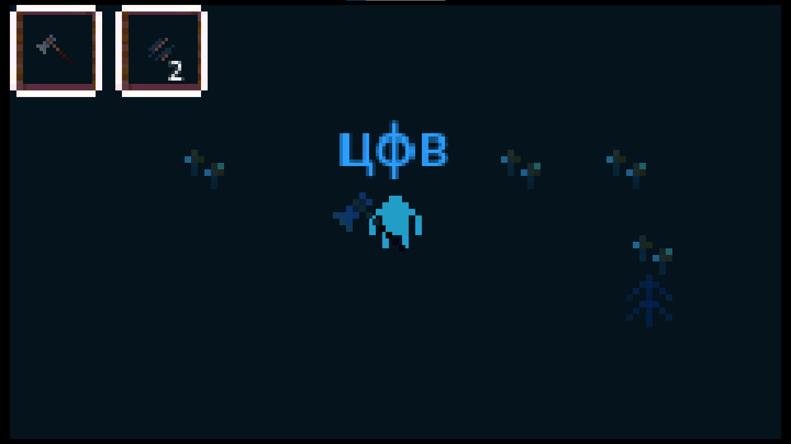

# Название проекта / Темы 

> **Дата:** 30.10.2026  
> **Автор (ФИО):** Новгородцев Кирилл Григорьевич 

--- 

## Описание проекта 
Стак в инвентаре, поднятие и сбрасывание предметов

## Стек проекта 
* **Игровой движок / Платформа:** Например: Godot Engine 4.x 
* **Язык программирования:** Например: GDScript / C# 
* **Дополнительные инструменты:** Например: Git, Aseprite, Blender 

## Что было использовано в проекте 
* **Узлы (Nodes):** Например: Area2D, CanvasLayer, CharacterBody2D 
* **Паттерны / Подходы:** Например: Глобальный код (Global.gd), Сигналы (Signals) 
* **Ресурсы:** Например: Кастомные спрайты, UI-шрифты 

## Самостоятельные работы 
* **Имя игрока**: Да 
* **Переход на другую сцену**: Да